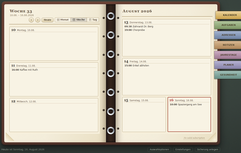
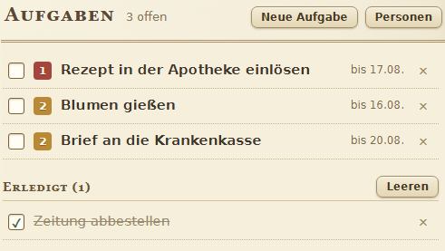
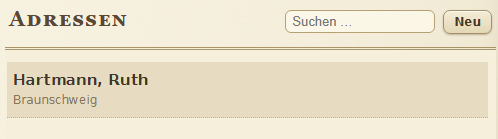

<p align="center">
  
</p>

<p align="center">
  <strong>Your private organizer, designed like a real book.</strong><br>
  Calendar, tasks, contacts and notes for Linux, Windows and Android.
</p>

<p align="center">
  <a href="README.DE.md">Deutsch</a> · <strong>English</strong> ·
  <a href="https://github.com/maik3531/Magnolie-Organizer/releases/latest">Downloads</a> ·
  <a href="CHANGELOG.md">Changelog</a>
</p>

<p align="center">
  <a href="https://github.com/maik3531/Magnolie-Organizer/releases/latest"></a>
  <a href="https://github.com/maik3531/Magnolie-Organizer/releases"></a>
  
  
</p>

## A personal organizer, not another cloud account

Magnolie brings the familiar feeling of a leather-bound paper organizer to the
desktop and phone. It keeps appointments, tasks, contacts, notes, anniversaries,
planning and health records together while putting local storage and explicit
sharing first.

- **One visual language:** leather, paper, rings and tabs across desktop and mobile.
- **Local-first:** your primary data stays on your devices.
- **Private synchronization:** Magnolienbaum exchanges approved content directly
  over the local network, VPN or a configured remote endpoint.
- **Useful imports:** calendars, vCards, Lotus Organizer data and common note exports.
- **Accessible:** keyboard navigation, optional focus outlines and scalable layouts.
- **20 interface languages:** including English, German, French, Spanish, Arabic,
  Japanese and Ukrainian.

## Download

| Platform | Recommended package | Alternative |
|---|---|---|
| Linux | [Flatpak x86_64](https://github.com/maik3531/Magnolie-Organizer/releases/latest/download/Magnolie-Organizer-2.0.28-x86_64.flatpak) | [AppImage](https://github.com/maik3531/Magnolie-Organizer/releases/latest/download/Magnolie-Organizer-2.0.28-x86_64.AppImage) · [Debian package](https://github.com/maik3531/Magnolie-Organizer/releases/latest/download/magnolie-organizer_2.0.28_all.deb) |
| Windows 10/11 x64 | [Setup](https://github.com/maik3531/Magnolie-Organizer/releases/latest/download/Magnolie-Organizer-Windows-2.0.28-Setup-x64.exe) | [Portable ZIP](https://github.com/maik3531/Magnolie-Organizer/releases/latest/download/Magnolie-Organizer-Windows-2.0.28-x64.zip) |
| Android | [Magnolie Notes APK](https://github.com/maik3531/Magnolie-Organizer/releases/latest/download/Magnolie-Notes-1.0.20.apk) | Android 8.0 or newer |
| Handbook | [Debian package](https://github.com/maik3531/Magnolie-Organizer/releases/latest/download/magnolie-handbuch_2.0.28_all.deb) | Included as an optional Windows component |

### Main DEB application – including KDE Plasma

**`magnolie-organizer_2.0.28_all.deb` contains the complete application.**
Use it on KDE Plasma as well, including Kubuntu or Ubuntu-based TuxedoOS.
GNOME, Cinnamon, Xfce and KDE use the same main package.

### Optional KDE integration add-on – main application required

**`magnolie-organizer-kde` only adds access to existing KDE/Akonadi calendars
and address books. It contains no separate Organizer interface and does not
replace the main application.** The add-on has a mandatory dependency on
`magnolie-organizer`. APT installs an available main package alongside it;
installation is rejected if that dependency cannot be satisfied. When using
downloaded DEBs, install both files together:

```bash
sudo apt install ./magnolie-organizer_2.0.28_all.deb ./magnolie-organizer-kde_2.0.28_amd64.deb
```

The main package alone is sufficient to run Organizer on KDE. The add-on is
only needed to access calendars/address books configured in KDE.

| Distribution | KDE integration add-on (amd64 / x86_64; main application required) |
|---|---|
| Debian 13, Ubuntu / Kubuntu 24.04 and 26.04, Linux Mint 22 | [KDE add-on DEB](https://github.com/maik3531/Magnolie-Organizer/releases/latest/download/magnolie-organizer-kde_2.0.28_amd64.deb) |
| Fedora 42 | [KDE add-on RPM](https://github.com/maik3531/Magnolie-Organizer/releases/latest/download/magnolie-organizer-kde-2.0.28-1.fc42.x86_64.rpm) |

The optional KDE DEB selects one of three internal native backends from the
existing, configured KDE packages and their complete ABI dependencies. It does not
install KDE PIM. There is no transitional-package download.

**KDE add-on installed but unavailable?** A fresh TUXEDO installation may lack
the Akonadi runtime even though Plasma is present. If you want to connect KDE
calendars or address books, install the prerequisites from your configured
distribution repositories:

```bash
sudo apt install akonadi-server kdepim-runtime
/usr/libexec/magnolie-organizer/magnolie-akonadi-helper --check
```

The check does not start an Akonadi server or change accounts. Success reports
`"ok": true` and `"activated": false`. The internal profile name follows the
installed KDE libraries rather than the distribution name; `ubuntu26.04` can
therefore be correct on TUXEDO with an Ubuntu 24.04 base. To synchronize, the
desired calendars or address books must also be configured in KDE and selected
in Organizer.

Users of the former
package explicitly install `magnolie-organizer-kde`; versioned package relations
preserve upgrades from released 1.0.0. The suffixed 2.0.19 files were unreleased test
candidates and sort above 2.0.19 in dpkg: replacing them requires an explicit tester
downgrade decision. See [KDE requirements and upgrade policy](magnolie-organizer/native/akonadi-helper/DEB-TARGETS.md).

### Removing an AppImage: disable reminders and background starts first

An AppImage has no package uninstaller. When reminders are configured, Magnolie
uses **systemd** in the Linux user session among its startup mechanisms:
`magnolie-erinnerung.timer` regularly starts `magnolie-erinnerung.service`.
Since **2.0.28**, AppImage registrations use a small standalone launcher and a
user path unit to detect deletion or movement of that image. Missing-image
cleanup disables and removes only the timer, service and autostart entries bound
to that exact launcher, then reloads the user manager and clears stale failures.
It leaves personal documents and registrations of a replacement image intact.
The launcher also checks before starting at the next login. On startup the new
Organizer retires the reported legacy reminder pair if its AppImage is missing.

**Older AppImages** referenced their executable directly. Deleting such an image
does not remove its entries; a leftover timer can produce a failed start and new
journal messages every minute. The following manual steps cover those older units.

**Before deleting the file**, disable the configured reminders and background
starts in Organizer, then exit the application. If the AppImage was already
deleted, disable the old user units in a terminal **without `sudo`**:

```bash
systemctl --user disable --now magnolie-erinnerung.timer magnolie-erinnerung.service
systemctl --user show magnolie-erinnerung.timer magnolie-erinnerung.service -p FragmentPath
```

The second command identifies the actual unit files. Magnolie-generated entries
normally reside beneath `${XDG_CONFIG_HOME:-$HOME/.config}`. If the displayed
paths confirm these old Magnolie entries, remove only those files:

```bash
rm -f -- "${XDG_CONFIG_HOME:-$HOME/.config}/systemd/user/magnolie-erinnerung.service" \
          "${XDG_CONFIG_HOME:-$HOME/.config}/systemd/user/magnolie-erinnerung.timer" \
          "${XDG_CONFIG_HOME:-$HOME/.config}/autostart/magnolie-erinnerung.desktop"
systemctl --user reset-failed magnolie-erinnerung.service
systemctl --user daemon-reload
```

`reset-failed` clears this service's failed-state display, not previous
journal entries. If a unit is stored elsewhere, inspect its displayed
`FragmentPath`. Personal Organizer documents and backups do not need to be
deleted. For AppImage updates, use a stable location and configure the service
again in the new Organizer so it references the current file.

SHA-256 checksums and source archives are attached to the
[latest release](https://github.com/maik3531/Magnolie-Organizer/releases/latest).

## A look inside

<table>
  <tr>
    <td width="50%"></td>
    <td width="50%"></td>
  </tr>
  <tr>
    <td align="center"><strong>Week at a glance</strong></td>
    <td align="center"><strong>Tasks that stay manageable</strong></td>
  </tr>
</table>

<p align="center">
  <br>
  <strong>Contacts presented as familiar index cards</strong>
</p>

## Project family

| Component | Technology | Source |
|---|---|---|
| Magnolie Organizer for Linux | Python 3, GTK 3, WebKit2GTK | [`magnolie-organizer`](magnolie-organizer/) |
| Magnolie Organizer for Windows | C#, .NET 8, WinForms, WebView2 | [`magnolie-organizer-windows`](magnolie-organizer-windows/) |
| Magnolie Notes for Android | Kotlin, Jetpack Compose | [`magnolie-notes`](magnolie-notes/) |
| Magnolie Handbook | Python, GTK, HTML/CSS/JavaScript | [`magnolie-handbuch`](magnolie-handbuch/) |

The repository contains the sources for release 2.0.28 / Notes 1.0.20; generated
packages are kept on the Releases page rather than in Git history.

## Security and privacy

Magnolie is built around local files, encrypted data exchange and explicit trust
between paired devices. No signing keys, credentials or private configuration
belong in this repository. Please report security issues privately as described
in [SECURITY.md](SECURITY.md).

## Contributing

Bug reports, translations and focused improvements are welcome. Start with
[CONTRIBUTING.md](CONTRIBUTING.md), use the issue templates, and keep changes
scoped to one component whenever possible.

## License

Program and handbook sources are licensed under **GPL-3.0-or-later** unless a
file states otherwise. Third-party fonts retain their included licenses. The
protected coffee QR and portrait have a separate, limited
[usage permission](PROTECTED-ASSETS-LICENSE.txt).
See [LICENSE.md](LICENSE.md) for the repository-wide overview.
